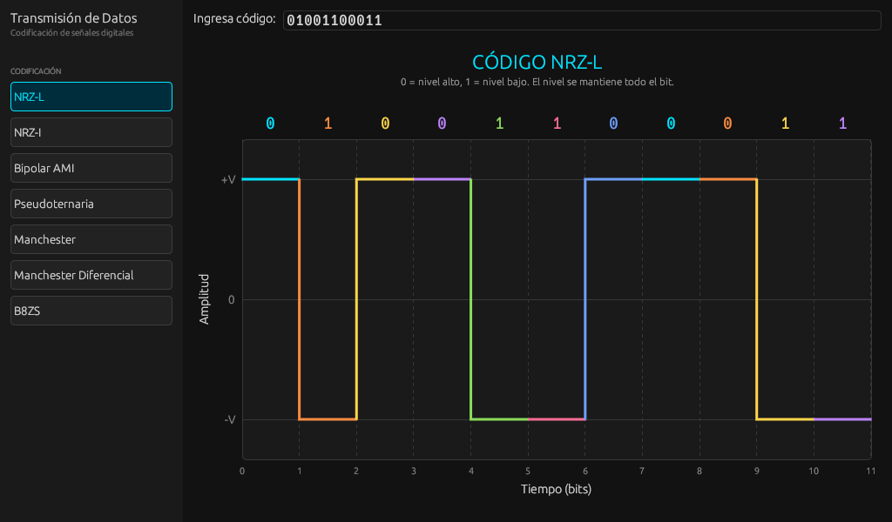
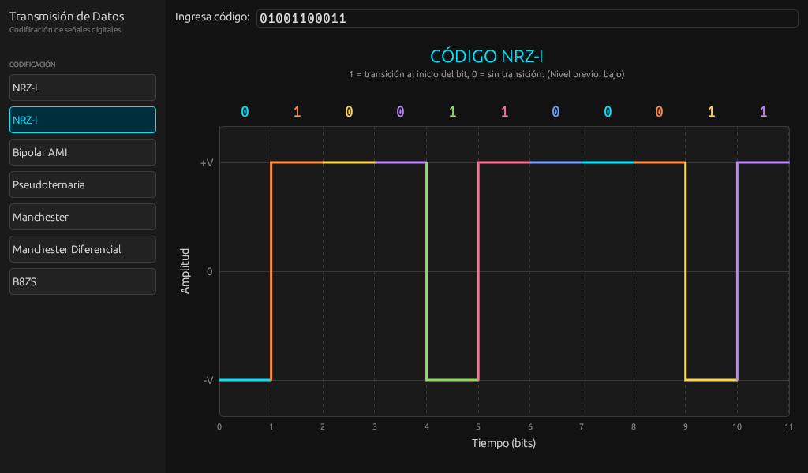
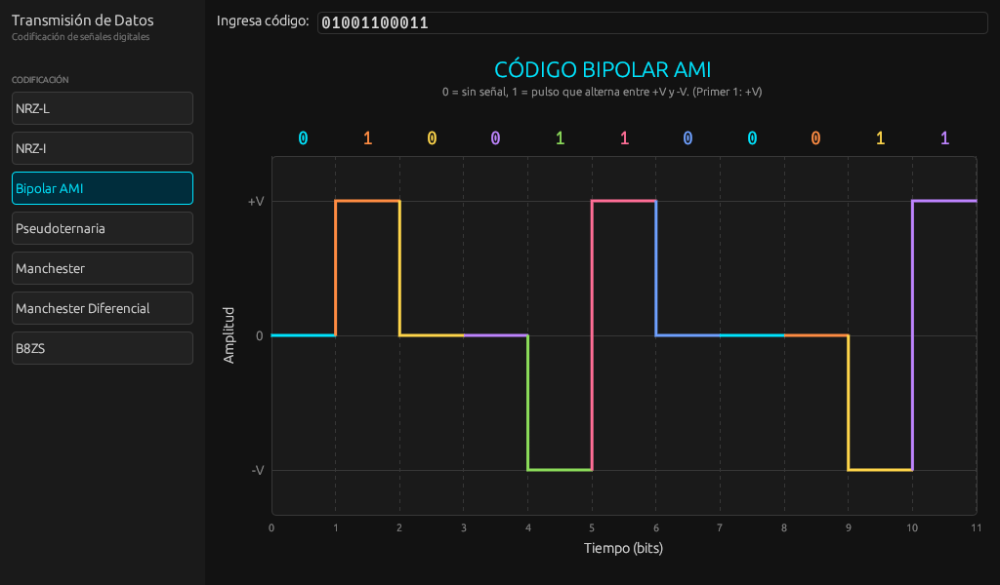
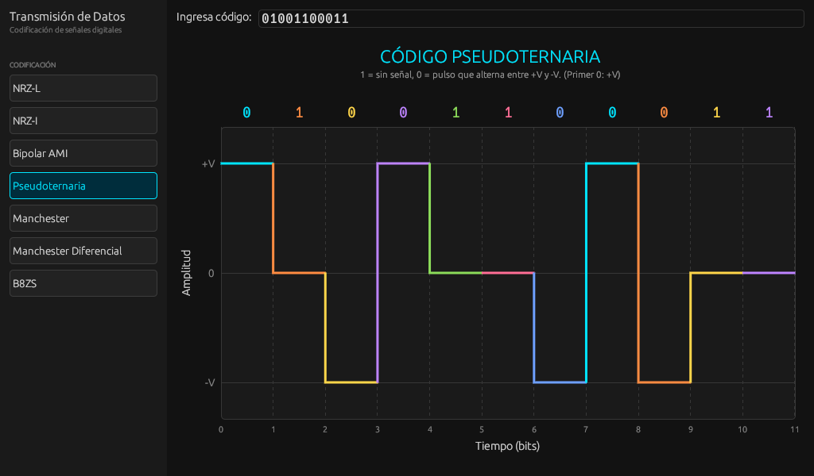
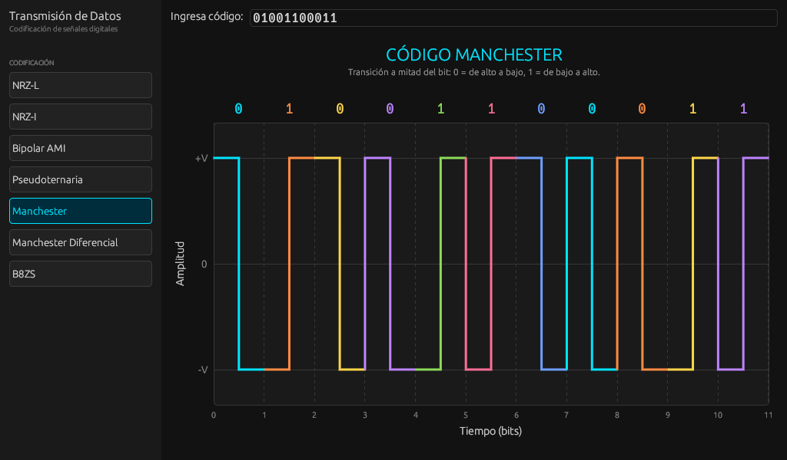
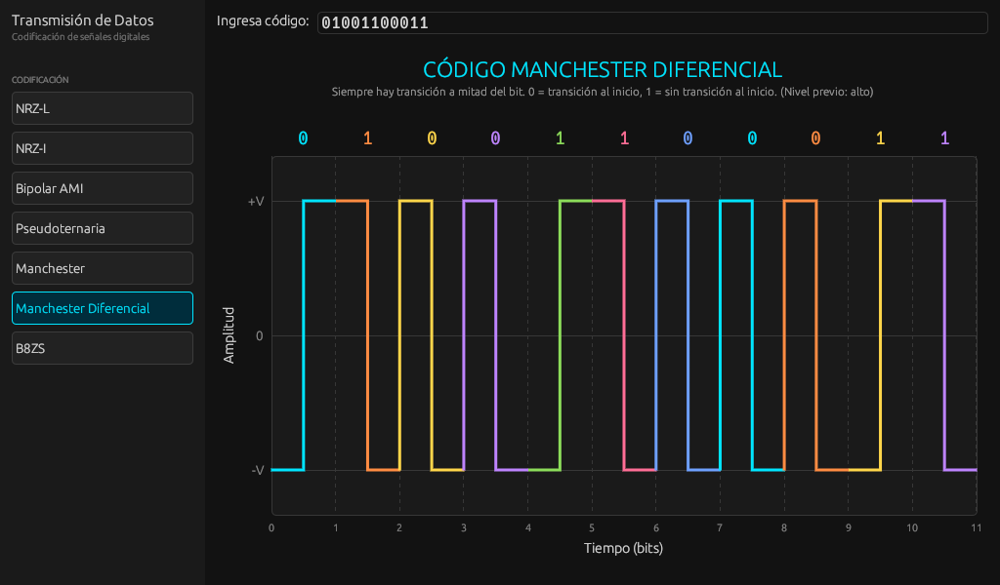
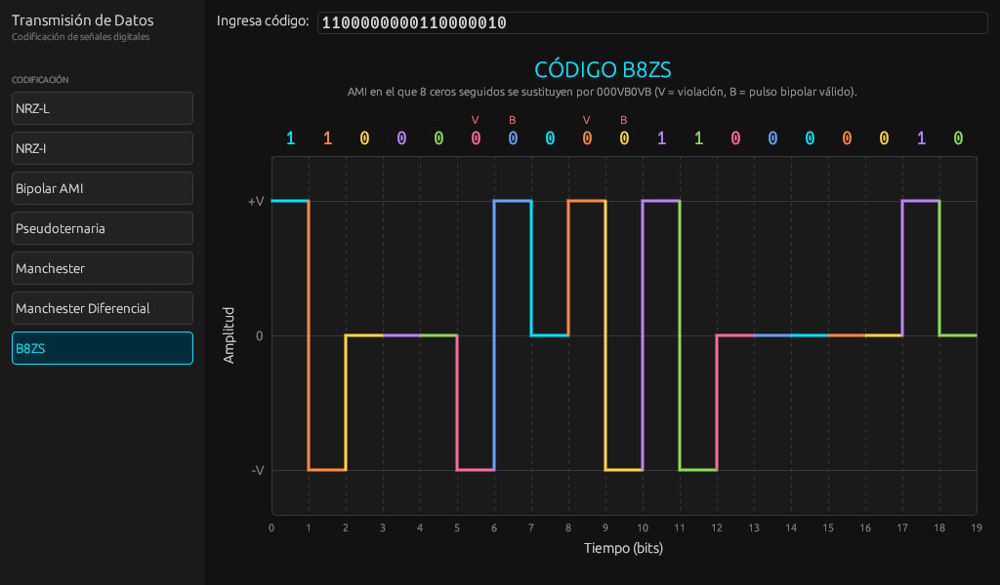

# Proyecto Final de Transmisión de Datos

## Codificación de señales digitales

**Universidad Autónoma del Estado de México**

- **Unidad de aprendizaje:** Transmisión de Datos
- **Alumno(s):** _[nombre]_
- **Profesor(a):** _[nombre]_
- **Grupo:** _[grupo]_
- **Fecha:** _[fecha]_

---

## Índice

1. [Introducción](#1-introducción)
2. [Descripción del programa](#2-descripción-del-programa)
3. [Codificaciones](#3-codificaciones)
   1. [NRZ-L](#31-nrz-l)
   2. [NRZ-I](#32-nrz-i)
   3. [Bipolar AMI](#33-bipolar-ami)
   4. [Pseudoternaria](#34-pseudoternaria)
   5. [Manchester](#35-manchester)
   6. [Manchester Diferencial](#36-manchester-diferencial)
   7. [B8ZS](#37-b8zs)
4. [Resumen de las reglas](#4-resumen-de-las-reglas)
5. [Referencias](#5-referencias)

---

## 1. Introducción

Para transmitir datos digitales por un medio físico, los bits deben convertirse en
una señal: una secuencia de niveles de tensión a lo largo del tiempo. La regla que
establece qué nivel (o qué cambio de nivel) corresponde a cada bit se llama
**codificación de línea**. La elección de la codificación determina el ancho de
banda que ocupa la señal, si tiene componente de continua, la facilidad con la que
el receptor se sincroniza con el emisor y la capacidad de detectar errores.

En este proyecto se desarrolló un programa que recibe una cadena de bits y
muestra la gráfica de la señal resultante para siete codificaciones: NRZ-L, NRZ-I,
Bipolar AMI, Pseudoternaria, Manchester, Manchester Diferencial y B8ZS.

## 2. Descripción del programa

El programa está escrito en **Rust** y usa la biblioteca **egui/eframe** para la
interfaz gráfica. Funciona de la siguiente manera:

- En el campo **«Ingresa código»** el usuario escribe la cadena de bits. Si la
  cadena contiene un carácter distinto de `0` o `1`, se muestra un aviso en lugar
  de la gráfica.
- En el panel izquierdo hay un **botón por cada codificación**; el botón
  seleccionado queda resaltado.
- En el área central se muestra el nombre de la codificación, una breve
  descripción de su regla y la **gráfica de la señal**: el eje horizontal es el
  tiempo (en intervalos de bit) y el vertical la amplitud (+V, 0, −V). Cada bit se
  dibuja de un color distinto y su valor aparece encima de su intervalo.

El código se organiza en dos partes: `src/core/codificacion.rs` contiene la lógica
de las codificaciones (independiente de la interfaz y con pruebas unitarias), y
`src/ui/` contiene la pantalla y el componente que dibuja la gráfica.

Para ejecutarlo:

```
cargo run --release
```

Las capturas de las secciones siguientes usan la cadena `01001100011`, excepto
B8ZS, que usa `1100000000110000010` para que aparezca una secuencia de ocho ceros.

## 3. Codificaciones

### 3.1 NRZ-L

**No retorno a cero, nivel** (*Nonreturn to Zero-Level*). Es la codificación más
simple: cada bit se representa con un nivel de tensión constante durante todo el
intervalo de bit.

Cómo se lleva a cabo:

- `0` → nivel alto (+V)
- `1` → nivel bajo (−V)

Es fácil de implementar y aprovecha bien el ancho de banda, pero tiene componente
de continua y, ante una secuencia larga de bits iguales, la señal no cambia, por lo
que el receptor puede perder la sincronización.



### 3.2 NRZ-I

**No retorno a cero, invertido** (*Nonreturn to Zero, Invert on ones*). Es una
codificación **diferencial**: la información no está en el nivel, sino en si hay o
no un cambio de nivel al comienzo del intervalo de bit.

Cómo se lleva a cabo:

- `1` → hay transición al inicio del bit (el nivel se invierte)
- `0` → no hay transición (se mantiene el nivel anterior)

En el programa se supone que el nivel previo al primer bit es bajo. Su ventaja es
que es más fiable detectar una transición que comparar un nivel con un umbral, y
que la señal sigue siendo válida aunque se invierta la polaridad de los cables.
Una secuencia larga de ceros sigue dejando la señal sin transiciones.



### 3.3 Bipolar AMI

**Inversión de marca alternada** (*Alternate Mark Inversion*). Es una codificación
multinivel que usa tres niveles: +V, 0 y −V.

Cómo se lleva a cabo:

- `0` → ausencia de señal (nivel 0)
- `1` → un pulso, positivo o negativo, alternando la polaridad con respecto al
  `1` anterior

En el programa el primer `1` se envía como pulso positivo. Al alternar los pulsos
no hay componente de continua, las secuencias largas de unos no provocan pérdida
de sincronización y un pulso que no respete la alternancia permite detectar un
error. El problema que persiste son las secuencias largas de ceros.



### 3.4 Pseudoternaria

Es la codificación complementaria de AMI: se intercambian los papeles del `0` y
del `1`.

Cómo se lleva a cabo:

- `1` → ausencia de señal (nivel 0)
- `0` → un pulso, positivo o negativo, alternando la polaridad con respecto al
  `0` anterior

En el programa el primer `0` se envía como pulso positivo. Tiene las mismas
propiedades que AMI, pero en este caso son las secuencias largas de unos las que
dejan la línea sin señal.



### 3.5 Manchester

Es una codificación **bifase**: siempre hay una transición a la mitad de cada
intervalo de bit. Esa transición sirve a la vez como dato y como reloj.

Cómo se lleva a cabo (convención de Stallings / IEEE 802.3):

- `0` → transición de alto a bajo a mitad del bit
- `1` → transición de bajo a alto a mitad del bit

Como todos los bits tienen una transición, el receptor puede sincronizarse con
ella (codificación autosincronizada), no hay componente de continua y la ausencia
de una transición esperada indica un error. A cambio, requiere el doble de ancho
de banda que NRZ. Se usa en redes Ethernet a 10 Mbps.



### 3.6 Manchester Diferencial

También es bifase: mantiene la transición a mitad del bit, pero esta solo se usa
para la sincronización. El dato se codifica con la presencia o ausencia de una
transición **al inicio** del intervalo.

Cómo se lleva a cabo:

- `0` → hay transición al inicio del bit
- `1` → no hay transición al inicio del bit
- En ambos casos hay siempre una transición a mitad del bit

En el programa se supone que el nivel previo al primer bit es alto. Conserva las
ventajas de Manchester y añade las de la codificación diferencial (es inmune a la
inversión de polaridad). Se usa en redes Token Ring (IEEE 802.5).



### 3.7 B8ZS

**Bipolar con sustitución de 8 ceros** (*Bipolar with 8-Zeros Substitution*). Es
una técnica de **aleatorización** (*scrambling*) basada en AMI que resuelve su
problema con las secuencias largas de ceros.

Cómo se lleva a cabo:

- Se codifica como en Bipolar AMI.
- Cuando aparecen **ocho ceros consecutivos**, se sustituyen por un patrón que
  contiene dos violaciones del código AMI:
  - si el último pulso fue **positivo**: `0 0 0 + − 0 − +`
  - si el último pulso fue **negativo**: `0 0 0 − + 0 + −`

El patrón se puede escribir como `000VB0VB`, donde **V** es una violación (un
pulso con la misma polaridad que el pulso anterior) y **B** es un pulso bipolar
válido (polaridad alternada). El receptor reconoce las dos violaciones, que no
pueden deberse al azar con facilidad, y las reemplaza de nuevo por ocho ceros. Así
la señal siempre tiene transiciones suficientes para mantener la sincronización,
sin componente de continua y sin aumentar la velocidad de transmisión.

En la captura, los ocho ceros que siguen a los dos primeros unos se sustituyen por
`000−+0+−`, porque el último pulso antes de ellos fue negativo; las marcas V y B
aparecen sobre los bits correspondientes. Los cinco ceros posteriores no se
sustituyen porque no llegan a ocho.



## 4. Resumen de las reglas

| Codificación | Bit 0 | Bit 1 |
|---|---|---|
| NRZ-L | Nivel alto | Nivel bajo |
| NRZ-I | Sin transición al inicio | Transición al inicio |
| Bipolar AMI | Sin señal | Pulso de polaridad alternada |
| Pseudoternaria | Pulso de polaridad alternada | Sin señal |
| Manchester | Transición alto → bajo a mitad del bit | Transición bajo → alto a mitad del bit |
| Manchester Diferencial | Transición al inicio (y a la mitad) | Sin transición al inicio (solo a la mitad) |
| B8ZS | Como AMI; ocho ceros seguidos → `000VB0VB` | Pulso de polaridad alternada |

## 5. Referencias

- Stallings, W. *Comunicaciones y Redes de Computadores*. Pearson Educación.
  Capítulo «Técnicas para la codificación de señales».
- Forouzan, B. A. *Transmisión de Datos y Redes de Comunicaciones*. McGraw-Hill.
